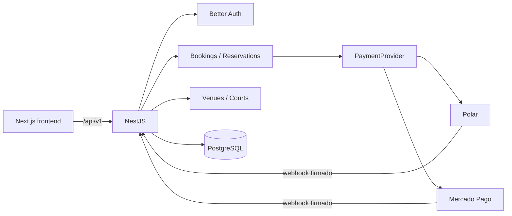

# La Gambeta — API

API de reservas deportivas para La Gambeta. Centraliza autenticación, sedes, canchas, disponibilidad, reservas y pagos dentro de una arquitectura modular construida con NestJS y PostgreSQL.

> **Modo portafolio:** Polar se usa en modo Sandbox de forma predeterminada. No se deben introducir tarjetas ni credenciales reales en una demostración pública.

## Capacidades

- Autenticación por email y Google con Better Auth y sesiones seguras en cookies.
- Verificación de email, recuperación de contraseña y perfiles de usuario.
- Roles `USER`, `OWNER` y `ADMIN` con autorización por ruta.
- CRUD de sedes y canchas.
- Disponibilidad y reservas protegidas contra solapamientos en PostgreSQL.
- Checkout mediante un puerto de pagos con adaptadores para Polar y Mercado Pago.
- Webhooks firmados, idempotencia y transiciones de estado protegidas.
- Health check, validación global, Helmet, CORS, rate limiting y Swagger.

## Stack

- NestJS 11 y TypeScript estricto.
- PostgreSQL 17, Drizzle ORM y migraciones SQL versionadas.
- Better Auth con adaptador Drizzle.
- API de Polar y Mercado Pago detrás de `PaymentProvider`.
- Nodemailer y Handlebars para emails transaccionales.
- Jest, ESLint y Swagger/OpenAPI.

## Arquitectura



`BookingsService` es la autoridad del dominio de reservas. `ReservationsService` coordina la reserva con el checkout, y los proveedores de pago implementan un puerto común para evitar acoplar el negocio a una pasarela.

## Ejecución local

### Requisitos

- Node.js 20 o superior.
- pnpm 10 o superior.
- Docker con Compose, o una instancia PostgreSQL 17 accesible.

### Instalación

```bash
git clone https://github.com/EmmanuelML78/la-gambeta-back.git
cd la-gambeta-back
cp .env.example .env
pnpm install
docker compose up -d db
pnpm db:migrate
pnpm start:dev
```

Servicios locales:

- API: [http://localhost:3001/api/v1](http://localhost:3001/api/v1)
- Health: [http://localhost:3001/api/v1/health](http://localhost:3001/api/v1/health)
- Swagger: [http://localhost:3001/api/docs](http://localhost:3001/api/docs)

## Configuración

Las variables completas y sus valores seguros de ejemplo están en [`.env.example`](./.env.example).

### Variables esenciales

| Grupo | Variables |
| --- | --- |
| Aplicación | `PORT`, `NODE_ENV`, `FRONTEND_URL`, `BACKEND_URL` |
| Base de datos | `DATABASE_HOST`, `DATABASE_PORT`, `DATABASE_USERNAME`, `DATABASE_PASSWORD`, `DATABASE_NAME`, `DATABASE_SSL` |
| Autenticación | `BETTER_AUTH_SECRET`, `REQUIRE_EMAIL_VERIFICATION` |
| Email | `MAIL_HOST`, `MAIL_PORT`, `MAIL_USER`, `MAIL_PASSWORD`, `MAIL_FROM` |
| Polar | `PAYMENT_PROVIDER`, `POLAR_ACCESS_TOKEN`, `POLAR_PRODUCT_ID`, `POLAR_WEBHOOK_SECRET`, `POLAR_SERVER` |

Genera un secreto de producción con:

```bash
openssl rand -base64 32
```

Para desarrollo sin SMTP se puede mantener `REQUIRE_EMAIL_VERIFICATION=false`. En producción, configura un servidor SMTP real antes de activarlo.

## Superficie HTTP

Todas las rutas de negocio usan el prefijo `/api/v1`.

| Recurso | Responsabilidad |
| --- | --- |
| `/auth/*` | Registro, sesión, OAuth y recuperación administrados por Better Auth |
| `/venues` | Consulta pública y administración de sedes |
| `/courts` | Catálogo, detalle y administración de canchas |
| `/bookings` | Disponibilidad, reservas del usuario y operaciones administrativas |
| `/reservations` | Creación coordinada con checkout, consulta, confirmación y cancelación |
| `/payments` | Preferencias, estado, métodos y webhooks |
| `/users/me` | Lectura y actualización del perfil autenticado |

Consulta los contratos exactos y DTO en Swagger.

## Comandos de calidad

```bash
pnpm exec jest --runInBand --no-cache
pnpm exec eslint "{src,apps,libs,test}/**/*.ts"
pnpm exec tsc --noEmit --incremental false
pnpm build
```

El flujo de CI ejecuta estas cuatro comprobaciones sin reescribir el código fuente y, en un
trabajo independiente, aplica las migraciones sobre PostgreSQL 17 antes de
ejecutar `pnpm test:auth:integration`. Este último usa únicamente la base de
pruebas `la_gambeta_auth_e2e` en loopback y credenciales sintéticas. El objetivo
`pnpm test:e2e` no está habilitado en CI: su fixture todavía espera la antigua
respuesta `Hello World!` en `/` y debe actualizarse antes de usarlo como gate.
Ejecuta `pnpm audit --prod` por separado; la auditoría no forma parte de CI.

## Despliegue

1. Aprovisiona PostgreSQL y configura `DATABASE_SSL=true` si el proveedor exige TLS.
2. Define `BACKEND_URL` con el origen HTTPS de esta API y `FRONTEND_URL` con el dominio final de Next.js.
3. Usa un `BETTER_AUTH_SECRET` único y configura SMTP y Polar con secretos del entorno.
4. Ejecuta `pnpm install --frozen-lockfile`, `pnpm db:migrate` y `pnpm build`.
5. Inicia el servicio con `pnpm start:prod` y comprueba `/api/v1/health`.
6. Registra `https://TU_BACKEND/api/v1/payments/webhook` en Polar y copia su secreto de firma.

Nunca ejecutes `db:push` en producción; las migraciones versionadas son la fuente de verdad.

## Repositorio relacionado

- [La Gambeta Frontend](https://github.com/EmmanuelML78/la-gambeta-front)
